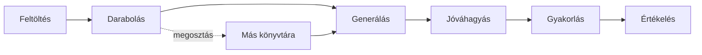

<!-- @slide Cím -->
<!-- @slide-theme slate blue slate -->
<!-- @slide-bg slate-900 -->

<!-- @set-colors blue sky slate -->
<!-- @gap 10 -->
# Tananyaghoz kötött feladatgeneráló és gyakorlóalkalmazás

<!-- @gap 6 -->
<!-- @color gray -->
Szerző: Vass Gergő Dániel  
Neptun: DYRKAU  
Témavezető: Sári Dávid  
Projektazonosító: 2026-SD-03  

---
<!-- @slide Probléma -->
<!-- @slide-theme slate blue slate -->
<!-- @slide-bg slate-900 -->

<!-- @set-colors blue sky slate -->
## _Probléma_

<!-- @gap 4 -->
<!-- @color gray -->
#### ___Gyakorolni vagy felkészülni egy tananyagból___  
- Manuálisan 
	- sok időt vesznek igénybe az előkészületek
	- nehéz a „jó” kérdések kigyűjtése és megfogalmazása
- Az AI
	- kérdései gyakran túl egyszerűek
	- általában csak feleletválasztós kérdésekre korlátozódik
	- a rövid válaszokat nem rögzített szempontok alapján értékeli
	- hamis felkészültségérzetet adhat

---
<!-- @slide Központi kérdés -->
<!-- @slide-theme slate blue slate -->
<!-- @slide-bg slate-900 -->

<!-- @set-colors blue sky slate -->
<!-- @gap 6 -->
## _Központi kérdés_

<!-- @gap 6 -->
<!-- @color gray -->
> Hogyan lehet gyorsan, kevés előkészülettel, megbízhatóan gyakorlókérdéseken és forrásokon keresztül segíteni egy tananyag tanulását?

---
<!-- @slide A projekt ötlete -->
<!-- @slide-theme slate blue slate -->
<!-- @slide-bg slate-900 -->

<!-- @set-colors blue sky slate -->
### _A projekt ötlete_

<!-- @gap 4 -->
<!-- @color gray -->
1. A felhasználó feltölti a saját jegyzetét.
2. A rendszer részekre bontja, és felismeri a fejezeteket.
3. Az AI kérdéseket generál forrásrészlettel együtt.
4. A felhasználó a részlet alapján jóváhagyja, javítja vagy elveti.
5. A kérdésbankból gyakorlósor készül, amelyet a rendszer értékel.

<!-- @gap 2 -->
<!-- @align center -->
<!-- @scale 85% -->
```text
1. jegyzet → 2. darabolás → 3. kérdés → 4. jóváhagyás → 5. gyakorlás
```

---
<!-- @slide Célfelhasználók -->
<!-- @slide-theme slate blue slate -->
<!-- @slide-bg slate-900 -->

<!-- @set-colors blue sky slate -->
## _Célfelhasználók_

<!-- @gap 2 -->
<!-- @color gray -->

<!-- @gap 4 -->
| Szerep     | Mit szeretne?                                 |
| ---------- | --------------------------------------------- |
| Tanuló     | Egyszerűen, hatékonyan tanulni és gyakorolni. |
| Tulajdonos | A saját jegyzetéből tanulni és megosztani.    |
| Oktató     | Megosztani a szakmailag hiteles tananyagát.   |

##### *___A szerepet a tananyaggal való viszony határozza meg.___*

---
<!-- @slide Tervezett hatókör -->
<!-- @slide-theme slate blue slate -->
<!-- @slide-bg slate-900 -->

<!-- @set-colors blue sky slate -->
## _Tervezett hatókör_

<!--@gap 7-->
<!-- @color gray -->
- .txt feltöltés, darabolás ellenőrzéssel
- Privát vagy nyilvános tananyag, saját kérdésbank
- AI-kérdések (feleletválasztós, rövid válaszos)
- Jóváhagyás, szerkesztés, nehézségi szint, duplikátumszűrés
- Kérdések érvénytelenítése a tananyag változásakor
- Tanulási mód, reprodukálható gyakorlósor
- Feleletválasztós: determinisztikus, rövid válasz: AI-rubric
- Haladáskövetés

---
<!-- @slide Kutatási rész -->
<!-- @slide-theme slate blue slate -->
<!-- @slide-bg slate-900 -->

<!-- @set-colors blue sky slate -->
### _Kutatási rész_

<!-- @gap 6 -->
<!-- @color gray -->
| Vizsgálat                 | Összehasonlítás               |
| ------------------------- | ----------------------------- |
| Kérdésgenerálás           | Teljes dokumentum vs. RAG     |
| Feladatsor-összeállítás   | Véletlenszerű vs. feltételes  |
| Rövid válaszok értékelése | AI-pontozás vs. kézi pontozás |

---
<!-- @slide Lehetséges bővítések -->
<!-- @slide-theme slate blue slate -->
<!-- @slide-bg slate-900 -->

<!-- @set-colors blue sky slate -->
### _Lehetséges bővítések_

<!-- @gap 7 -->
<!-- @color gray -->
- Hivatalos vizsgáztatás és osztályozás
- Kép-, hang- és videóalapú tananyag
- Kettőnél több feladattípus, esszéválaszok
- Külön oktatói fióktípus, saját modell tanítása
- További fájltípusok  
- Ellenőrzött oktatói jelölés  
- Linkes megosztás  
- Natív mobilalkalmazás

---
<!-- @slide Felhasználói utak -->
<!-- @slide-theme slate blue slate -->
<!-- @slide-bg slate-900 -->

<!-- @set-colors blue sky slate -->
## _Felhasználói utak_

<!-- @gap 15 -->


---
<!-- @slide Fő utak -->
<!-- @slide-theme slate blue slate -->
<!-- @slide-bg slate-900 -->

<!-- @set-colors blue sky slate -->
### _A három fő út_

<!-- @gap 4 -->
<!-- @color gray -->
**1. Saját jegyzetből gyakorlás**  
Feltöltés → kérdések jóváhagyása → gyakorlás

<!-- @gap 3 -->
**2. Megosztott tananyag**  
Nyilvánossá tétel → könyvtárhoz adás → saját kérdésbank

<!-- @gap 3 -->
**3. A tananyag megváltozik**  
Új verzió → érintett kérdések felülvizsgálata → csak naprakész kérdés

---
<!-- @slide Következő lépések -->
<!-- @slide-theme slate blue slate -->
<!-- @slide-bg slate-900 -->

<!-- @set-colors blue sky slate -->
## _Következő lépések_

<!-- @gap 4 -->
<!-- @color gray -->
- A RAG pontosítása (részletméret, visszakeresés)
- Adatmodell a verziókra, részletekre és kérdésbankokra
- Wireframe-ek és nyelvimodell-választás prototípussal
- Nyitott kérdés: mi legyen a kérdésbankokkal,  
  ha a tulajdonos visszavonja a megosztást?

---
<!-- @slide Köszönöm -->
<!-- @slide-theme slate blue slate -->
<!-- @slide-bg slate-900 -->

<!-- @set-colors blue sky slate -->
<!-- @gap 17 -->
<!-- @align center -->
# Köszönöm a figyelmet!

<!-- @color gray -->
<!-- @align center -->
Kérdések, észrevételek?